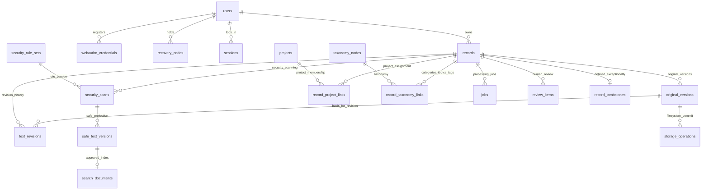

# M1 データベース・ER図設計書 v0.1

- 対応: ローカルAI長期記憶システム 条件定義書 v8.8、Q1〜Q86、F-001〜F-1460
- 対象: **M1のみ**（M2の会話同期・音声・iPhone、M3常駐/外部媒体、MCPは後続マイグレーション）
- ステータス: **設計ドラフト**。リリース依存関係の固定、TypeScript型チェック、Drizzleマイグレーション実行、Windows 11実機評価、セキュリティレビューは未完了
- 最重要方針: **原文・原音声・元文書・全原本版・人間の訂正履歴を原則無期限保存**。例外的削除は独立した人間承認・台帳手順。

## 1. ER図

図面ソース: [`er.mmd`](er.mmd)

## 2. テーブル一覧

| 分野 | テーブル | 目的 |
|---|---|---|
| 認証 | `users`, `webauthn_credentials`, `recovery_codes`, `sessions` | 認証・復旧コード・失効 |
| 記録 | `records`, `original_versions`, `text_revisions`, `storage_operations` | 不変原本、原本版、人間の訂正版、段階保存 |
| 分類 | `projects`, `record_project_links`, `taxonomy_nodes`, `record_taxonomy_links` | 複数案件、カテゴリ/話題/タグ |
| 機密 | `security_rule_sets`, `security_scans`, `safe_text_versions`, `review_items` | ルール先行検査、安全化派生本文、人間確認 |
| 検索 | `search_documents`, `search_index_versions`, `search_documents_fts` | 公開可の安全化文だけを索引化（FTSは別SQL） |
| 非同期 | `jobs`, `idempotency_requests` | 永続リース・再試行、HTTP再送の冪等性 |
| 監査・削除 | `audit_events`, `record_tombstones`, `ledger_anchors` | 重要操作・削除記録・独立台帳への紐付け |
| 設定・品質・復元 | `backup_generations`, `config_versions`, `model_profiles`, `model_evaluations` | DBの世代・復旧・モデル承認 |

合計27個の通常テーブル＋FTS仮想テーブル（上記の列挙に基づく）。

## 3. 保存場所の役割

- SQLite: 原本のID、保存先の**相対参照**、SHA-256、バイト数、機密検査、認証、ジョブ、監査。
- `originals/YYYY/MM/<UUID>`: 元のバイト列（上書き禁止）。
- `revisions/...`: 人間が確定・修正したテキストの不変バイト列。原本とは別。
- `derived/...`: 抽出テキスト・処理途中データ。原本とは区別する。
- `search_documents`: **安全化・承認済みの派生テキストのみ**。
- `runtime/staging`: 不完全なアップロード等。正式原本とは別。

保存先の相対パスはIDから構成し、元ファイル名をそのまま使用しない。Windowsのパス正規化・ジャンクション・NTFS ACLを検証する。DB内の保存先文字列だけで任意ファイルを開かない。

## 4. 主要なリレーションと制約

1. `records 1:N original_versions` — 同じ記録のバージョン番号 `(record_id, version_no)` を一意にする。
2. `records 1:N text_revisions` — 人間の訂正文は別ファイル・別行・別版にする。`parentRevisionId`が同じ記録の修正であることはServiceで検証する。
3. `records N:M projects` — 中間テーブル`record_project_links`で複数案件へ紐付ける。
4. `records N:M taxonomy_nodes` — カテゴリ・話題・タグは中間テーブルで管理し、分類提案と人間承認を区別する。
5. `original_versions/text_revisions -> security_scans -> safe_text_versions -> search_documents` — 解析やマスキングに失敗したデータを索引に載せない。
6. `users 1:N credentials, recovery_codes, sessions` — パスキー秘密鍵を保存しない。セッショントークンはハッシュのみ。
7. `records 1:0..1 record_tombstones` — 例外的完全削除をした証跡とシーケンスを残す。古いバックアップからの復活防止に使用。
8. 主キーはUUID文字列、時刻はUTCエポックミリ秒INTEGER、バイト数はINTEGERとする。
9. 重要データの外部キー削除方針は`RESTRICT`を基本とする。**原本・訂正履歴へCASCADE DELETEを使用しない。**
10. Drizzleの`text({enum})`は型推論の補助であり、SQLでの値域検査をそれだけに依存しない。主要な状態はServiceのZodとDBのCHECK/トリガーで追加検証する。

## 5. 原本を新規保存する処理（2フェーズ・復旧可能）

1. 認証・入力上限・ディスク空き容量・冪等性キーを検証する。
2. `records` / `original_versions(STAGED)` / `storage_operations(PREPARED)` の作成に必要な状態を確保。
3. 原本のストリームをステージングへ保存しSHA-256・サイズを検証する。
4. 必要なファイル同期後に同一ボリューム内で原本保管領域へ安全に移す。
5. `storage_operations(FILE_READY)`を確認し、SQLiteトランザクションで`original_versions(COMMITTED)`, `records(ACTIVE)`, ジョブを確定する。
6. 失敗やWindows再起動時はジョブと原本ファイルをハッシュで再照合する。成功確認前に冪等性応答を`COMPLETED`としない。
7. 「原本保存完了」「機密検査完了」「索引済み」を異なる状態として表示する。

**注意:** SQLiteトランザクションとNTFSファイルの移動は単一トランザクションではない。`storage_operations`とファイルハッシュにより復旧を行う。

## 6. 人間の訂正

- 既存`original_versions`をUPDATEして原文を書き換えない。
- 新しい`text_revisions`に訂正文・親版・編集者・日時・SHA-256を記録する。
- 新しい訂正文の機密検査が完了するまでAI・FTS5へ渡さない。
- AIの再出力は人間確定済み訂正文を自動上書きしない。
- `integrity_guardrails.sql`で原本・訂正の不変列をUPDATE禁止・行DELETE禁止とする。

## 7. 機密とFTS5

- `security_scans`: 原本版または訂正版のどちらか一方を参照、ルール版・区分・状態を記録する。
- `safe_text_versions`: スキャン済みの安全化タイトル・本文を格納する。ステータス`APPROVED`のみ公開候補。
- `search_documents`: `APPROVED`な安全化本文を**最終的な公開チェック後に**複製する。現時点の安全な既定値はPUBLIC/INTERNALのみ。CONFIDENTIAL/RESTRICTED/UNKNOWNの通常FTS公開を禁止する。
- FTS5: `search_documents`をexternal-contentとするtrigram索引。INSERT/DELETE/UPDATEトリガーで整合させる。
- ルール失効・スキャン不合格・記録の非公開化では、`search_documents`行を撤回し、FTSからも削除する。
- 3文字以上の日本語検索はtrigram MATCH、1〜2文字は安全化テキストだけを対象とした上限付き代替検索を使う。
- `search_documents`の行が存在してもクエリ側で**ユーザー・案件・記録ステータスを再認可**する。
- プロンプトインジェクション含む原本文は命令として実行しない。

FTS5の作成と同期トリガーは`fts5_search.sql`をレビュー済みカスタムマイグレーションとして導入する。強制公開ガードは`integrity_guardrails.sql`を適用する。

## 8. インデックス設計

- 記録一覧: `(owner_user_id, status, created_at_ms)`
- 原本版: UNIQUE `(record_id, version_no)`
- 訂正版: UNIQUE `(record_id, revision_no)`
- ジョブ取得: `(status, available_at_ms)`
- セッション: UNIQUE `(token_hash)`
- WebAuthn: UNIQUE `(credential_id)`
- 冪等性: UNIQUE `(owner_user_id, operation, key_hash)`
- 検索: trigram FTS5 + `record_id/status`、別途認可条件のB-treeインデックス

100,000件の性能は未計測。Q76のp50/p95をWindows実機で測定する。

## 9. Drizzleのマイグレーションルール

1. `schema.ts`から`drizzle-kit generate`でSQLを生成しレビューする。
2. FTS5とSQLiteトリガーは専用カスタムSQLを使用する。
3. DBスキーマ変更前にQ75の整合的バックアップと隔離復元を完了する。
4. **本番のサーバー起動時に自動マイグレーションしない。**
5. `drizzle-kit push`を本番のスキーマ変更に使用しない。
6. `PRAGMA foreign_keys=ON`, `PRAGMA journal_mode=WAL`, `PRAGMA busy_timeout=5000`を運用構成として検証する。
7. 移行後に`PRAGMA integrity_check`, `PRAGMA foreign_key_check`、FTS索引検証を行う。
8. Windowsの保存先・NTFS ACL・モデル/SQLiteバージョンを検証する。

## 10. 受け入れテスト（M1 DB）

- [ ] 同じ原本ID・版番号の二重登録を防止
- [ ] 原本バイト列・SHA-256が一致
- [ ] 原本・訂正履歴の不変列UPDATEおよび行DELETEが拒否される
- [ ] 元原文を変えずに人間の訂正を新しい版として追加
- [ ] 失敗・UNKNOWN・RESTRICTEDの記録が通常FTS検索で漏れない
- [ ] 安全化タイトル・本文以外をFTS5へ登録できない
- [ ] 日本語3文字以上のtrigram検索、1〜2文字の安全な代替検索
- [ ] バージョン・案件・カテゴリを中間テーブルで安全に管理
- [ ] 復旧コード・セッションの平文秘密をDBに保管しない
- [ ] 再送・プロセス異常終了後にも原本の二重確定・取りこぼしがない
- [ ] 削除台帳・認証失効をバックアップ復旧時に照合する
- [ ] 新しい機密ルールで古い索引が失効する
- [ ] Windows 11実機で容量・WAL・ロック・ファイル復旧を検証
- [ ] 重要欠陥0件、人間の承認を得る（Q78）

## 11. 次に実装する順序

1. 依存パッケージの版を固定し、`schema.ts`を型チェックする。
2. 自動生成マイグレーションを確認し、FTS5/guardrailsのカスタムSQLを統合する。
3. 開発用SQLiteファイルで全テーブル作成・外部キー・トリガーテスト。
4. `OriginalStorageService`（不変ファイル＋SHA256＋ジャーナル）を実装する。
5. `POST /api/records` を開発用の認証済みテスト環境で実装する。
6. Vitestでファイル保存・二重登録・途中失敗からの復旧を検証する。
7. WebAuthn・機密検査・安全化本文が実装できるまで実際の機密情報を投入しない。

## 12. 未解決の詳細（開発前に確定する）

- Node.jsのSQLiteドライバーの最終選定（`better-sqlite3`または`node:sqlite`をWindows実機で検証）。
- Drizzle/TypeScriptのバージョン固定と生成SQLの差分レビュー。
- 出力のDB CHECK制約の網羅率と、復旧・承認・検索公開の状態遷移のDBトリガー詳細。
- 原本ストレージに保存する名前・権限・排他・ディレクトリ世代の詳細。
- 再解析時のsafe-text版の切替・索引失効の原子性。
- バックアップ・独立台帳の実装媒体と、失効台帳が失われたときの安全な復元停止。

この設計書は実装開始のドラフトであり、完成済み・セキュリティ評価済みとは主張しない。
